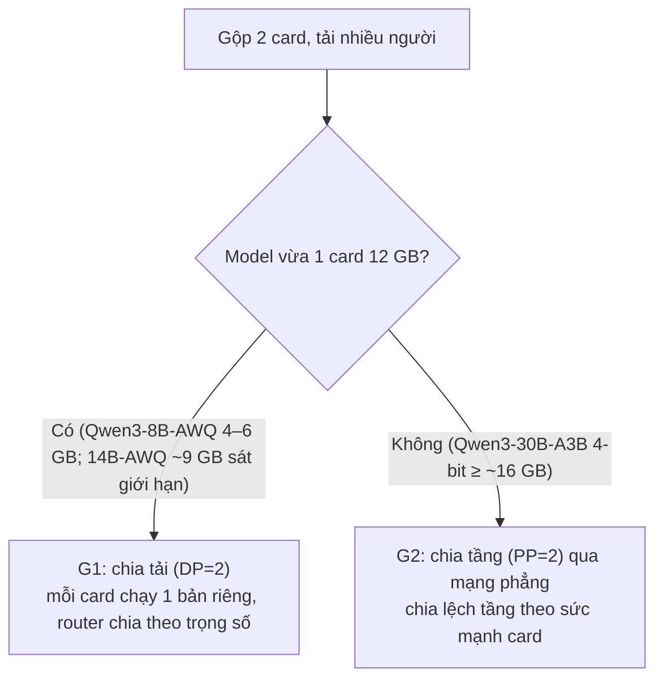

# KẾ HOẠCH: GỘP 2 GPU (`RTX 3060` Linux + `RTX 5070` Windows/WSL2) CHẠY TẢI LỚN VỚI SGLang & vLLM
*(Bản chốt 2026-10-31, đã đối chiếu số liệu với `P10_VLLM_WSL2.md`. Mục tiêu: **đo và so sánh**, không phải chứng minh vLLM/SGLang tốt. Kết luận "không khả thi" hoặc "giữ llama.cpp" là kết quả hợp lệ. Bàn giao cho Agent thực thi.)*

**MỤC ĐÍCH CỦA VIỆC GỘP (chủ dự án chốt 2026-10-31):** gộp 2 card để **(1) chạy được model LỚN hơn một card 12 GB chứa nổi** và **(2) chạy NHANH hơn khi chạy đơn lẻ** (cùng model, cách chạy đơn lẻ tốt nhất hiện có). Mọi pha và tiêu chí dưới đây phục vụ hai điều này; chia tải cho model nhỏ (DP) **không phải mục đích gộp** và chỉ là phần phụ (Phần 1.2).

**Quy ước nhãn:** `[ĐO]` đã đo trên cụm · `[ĐỌC MÃ]` đã đọc trong repo · `[TÀI LIỆU]` theo tài liệu, chưa kiểm · `[SUY LUẬN]` tính toán · `[CHƯA XÁC MINH]` phải thử. Con số không có `[ĐO]` là chưa đo. Báo cáo bằng tiếng Việt.

---

## PHẦN 0: HIỆN TRẠNG ĐÃ KIỂM CHỨNG

### 0.1. Số liệu nền (nguồn: `P10_VLLM_WSL2.md`, `p10_*.jsonl`)
**Một card, `Qwen3-8B` (llama.cpp Q4_K_M so với AWQ), thông lượng tổng `tok/s` `[ĐO]`:**

| Card / mức tải | llama.cpp | vLLM | SGLang | LMDeploy |
|---|---:|---:|---:|---:|
| RTX 3060, `C=8` | 147,72 | 203,66 | **207,41** (+40,4%) | 202,10 |
| RTX 3060, `C=16` | 234,23 | 256,96 | **206,96 (thấp hơn llama.cpp)** | **260,03** |
| RTX 3060, Best-of-N `C=8` chung prefix 2k | — | — | 250,81 (3,24×, bật RadixAttention) | 247,56 |
| RTX 5070 (WSL2), `C=16` | 497,21 (WSL2) | **537,51** | — | — |

(Còn: 5070 `C=8` SGLang 437,78, Best-of-N 475,64; decode 1 người 5070 SGLang 115,05 so với llama.cpp Windows 114,93. Đủ để thấy: **SGLang không thắng đồng đều** — ở `C=16` trên 3060 nó thua llama.cpp.)

**Gộp 2 card, `Qwen3-30B-A3B`, llama.cpp `--rpc 10.42.0.225:50052` `[ĐO]`:** `C=16` thông lượng tổng **233,14 tok/s**, người dùng thấp nhất 16,12 tok/s, **TTFT P95 = 3.693 ms**, VRAM 11.645 MiB (3060) + 9.912 MiB (5070); `C=8` **183,72 tok/s**; `C=4` 162,05; `C=1`: decode đơn 121,5–127,6 tok/s, thông lượng tổng 75,19 (có prefill).

**Sửa các số sai trong bản nháp trước:** `C=8` là **183,72** (không phải 214,08); TTFT P95 ở `C=16` là **3.693 ms** (không phải 12.175 ms); "tăng chưa tới 1,83×" so sánh hai thước đo khác nhau (decode `C=1` với thông lượng tổng `C=16`); theo cùng thước đo thông lượng tổng, `C=1 → C=16` là 75,19 → 233,14 (**≈3,1×**). Vậy "llama.cpp gộp card hụt hơi khi tải cao" **chưa đủ chứng cứ**; điều đo được là thông lượng tăng chậm dần và TTFT P95 tăng theo `C`.

**Mốc "chạy đơn lẻ" cho model lớn (cùng `Qwen3-30B-A3B`, không vừa 12 GB) `[ĐO]`:** llama.cpp một card `-ngl 99 -ncmoe 20` đạt **47,05 tok/s** decode 1 người (`C=4`: 53,99; P10 mục 10.3; các đợt P3/P8 trước đo 42–44 trên 3060 và ~65,6 trên 5070). **vLLM và SGLang không có thực thi lai CPU-expert**: với `--cpu-offload-gb 4` chúng chỉ đạt 6,35 và 6,19 tok/s (−90%, đọc nguyên lớp qua PCIe), nên **không có cách chạy đơn lẻ 30B bằng vLLM/SGLang** — mốc đơn lẻ đúng là llama.cpp `-ncmoe`. Gộp card bằng llama.cpp (`--rpc`) đã đạt **127,6 tok/s `C=1`, tức ≈ 2,7× chạy đơn lẻ** `[ĐO]`. Vậy mục (1)(2) với model 30B-A3B **llama.cpp gộp đã đạt**; vLLM/SGLang chỉ đáng dùng nếu gộp nhanh hơn hoặc ngang mức 127,6 (và vượt ở tải nhiều người dùng).

**Hệ quả quan trọng cho chế độ chia tải (DP):** đối chứng công bằng cho model 8B là **llama.cpp chạy riêng trên mỗi card rồi chia tải**, không phải llama.cpp gộp card 30B (khác model). Cộng số `C=16` đã đo: llama.cpp 234,23 + 497,21 ≈ **731 tok/s** `[SUY LUẬN từ số ĐO đơn lẻ, chưa đo chạy đồng thời]`; vLLM 256,96 + 537,51 ≈ **794** (cùng cách tính). Chênh chỉ ≈ +8,6%, **không phải 2,8–3,4×** như bản nháp. Mục tiêu "> 600 tok/s" bản nháp đã bị llama.cpp DP=2 vượt sẵn nên **bỏ**; tiêu chí mới ở Phần 4.

### 0.2. Chẩn đoán mạng WSL2 (khảo sát chỉ-đọc 2026-10-31) `[ĐO]`
| Hạng mục | Trạng thái |
|---|---|
| `pc-001` | `enp133s0` `10.42.0.1/24`, MTU 1500; có `/usr/bin/wg` và `iproute2` |
| `pc-win-01` Windows 10 Pro build 19045 | card cáp `Ethernet` (`ifIndex 19`) `10.42.0.225/24`; `vEthernet (WSL)` (`ifIndex 30`) `172.30.64.1/20`; **cả hai `Forwarding = Disabled`** |
| Mạng HNS của WSL2 | `Name: "WSL"`, `Type: "ICS"` (`SharedAccess` đang chạy), subnet `172.30.64.0/20` |
| WSL2 | bản phân phối `Ubuntu-24.04` (hiện `Stopped`), **nhân `5.15.167.4-microsoft-standard-WSL2`** (bản nháp ghi 6,6 là sai), `eth0` `172.30.76.133/20` |
| WireGuard trong WSL2 | **`CONFIG_WIREGUARD=y`, module built-in `[ĐO]`**; công cụ `wg` **chưa thấy cài** trong WSL (phải `apt install wireguard-tools`, cần mạng và xin phép) |
| Nguyên nhân P10-V4 thất bại | rank trong WSL2 báo IP `172.30.76.133` + cổng động cho rank 0 qua `TCPStore`; `pc-001` không có route tới `172.30.64.0/20` và Windows đang tắt forwarding ⇒ kết nối vào rớt (`[ĐO]` + `[SUY LUẬN]`) |

---

## PHẦN 1: GỘP ĐỂ CHẠY MODEL LỚN (CHÍNH) VÀ CHIA TẢI CHO MODEL NHỎ (PHỤ)

### 1.1. G2 (CHÍNH) — chia tầng bất đối xứng (PP=2) để chạy model lớn hơn một card
- **Bộ model đo (ca chính):** (a) `Qwen3-30B-A3B` 4-bit MoE (~16,9 GB `[TÀI LIỆU]`, 12+12 = 24 GB): đã có đối chứng đơn lẻ và gộp bằng llama.cpp; (b) **một model dense lớn hơn, ví dụ `Qwen3-32B` 4-bit (~18–20 GB `[CHƯA XÁC MINH]`)**: chạy đơn lẻ cực chậm hoặc không chạy (dense không offload hiệu quả như MoE `[SUY LUẬN]`), nên gộp card cho lợi ích lớn nhất về cả "model lớn hơn" lẫn "nhanh hơn". Đối chứng llama.cpp gộp cho (b) cần GGUF tương ứng (từng tải dở trên Windows `[CHƯA XÁC MINH còn dùng được]`); xin phép tải trước khi đo.
- **Thật thà về "nhanh hơn":** với model **vừa** một card, PP=2 không làm tăng tốc độ decode 1 người (bị card chậm kìm, cộng độ trễ mạng) `[SUY LUẬN]`; "nhanh hơn" chỉ có nghĩa với model **không vừa** một card (so với offload CPU) hoặc ở tải nhiều người dùng nhờ continuous batching. `14B-AWQ` (~9 GB) có thể vừa một card; **kiểm tra trước** rồi mới coi là ca G2 (nếu vừa thì không đo như ca gộp).
- Chia lệch tầng: `VLLM_PP_LAYER_PARTITION` (vLLM) và tùy chọn tương đương của SGLang `[TÀI LIỆU, CHƯA XÁC MINH tên cờ/biến trên SGLang 0.5.19]`. Tỷ lệ ban đầu 38:62 hoặc 42:58 (3060 : 5070) tùy VRAM; xác nhận bằng VRAM thực đo từng card, tính cả KV-cache.
- **Cổng khả thi model:** vLLM/SGLang phải chạy được `Qwen3-30B-A3B` 4-bit (GPTQ-Int4 hoặc AWQ, MoE) trên **cả `sm_86` và `sm_120`** `[CHƯA XÁC MINH]`. Nếu một bên không chạy MoE 4-bit, ghi lỗi chính xác và dừng G2.

### 1.2. G1 (PHỤ, không phải mục đích gộp) — chia tải (DP=2) cho model ≤ 8B (và 14B-AWQ nếu vừa)
- **Vì sao không PP=2 cho model nhỏ:** pipeline bị giới hạn bởi card chậm nhất (3060 chậm gần gấp đôi 5070: 63 so với 115 tok/s decode `[ĐO]`), card 5070 chờ `[SUY LUẬN]`.
- **Cách làm:** một server trên mỗi máy (`pc-001:18090`, `pc-win-01` trong WSL2 qua cổng cố định) và một router thử nghiệm trong runner. Gateway hiện **chưa có định tuyến theo trọng số** `[CHƯA XÁC MINH]`; tích hợp vào gateway là pha sau, ngoài phạm vi đo.
- **Trọng số 35:65 chỉ là điểm xuất phát** (suy từ decode 1 người 63:115). Ở tải cao tỷ lệ tối ưu có thể khác (đo `C=16`: 3060 ~234–260, 5070 ~497–537 ⇒ ~32:68). Phải **quét** trọng số `{30:70, 35:65, 40:60}` và chọn bằng số đo.
- Có ưu điểm bổ sung với RadixAttention/prefix-caching khi chia theo `session_id` (Best-of-N): ghi nhận riêng.

---

## PHẦN 2: GỠ RÀO CẢN MẠNG WSL2 TRÊN WINDOWS 10

Yêu cầu: hai tiến trình Linux (native `pc-001` và trong WSL2) phải kết nối được **hai chiều trên mọi cổng** với IP định danh nhất quán (`TCPStore`, `Gloo`, `NCCL` mở cổng động).

### Phương án M2 (**ưu tiên thử trước**): đường hầm WireGuard `pc-001` ↔ WSL2
- Chỉ thay đổi **bên trong WSL2** và trên Linux; **không đổi cấu hình hệ thống Windows** (forwarding, firewall). Chiều đi ra từ WSL2 tới `10.42.0.1` thông được `[ĐO]`; WireGuard dùng UDP nên hầm dựng từ phía WSL2, vượt ICS NAT.
- `pc-001`: `wg0` `10.99.0.1/24`, lắng nghe UDP `51820` trên `enp133s0` (cần mở trong firewall Linux nếu có). WSL2: `wg0` `10.99.0.2/24`, `Endpoint = 10.42.0.1:51820`, `PersistentKeepalive = 15`.
- Khóa WireGuard sinh trong thư mục scratch, **không đưa vào repo/log**. MTU: đặt `wg0` ≤ 1380 (để chừa tiêu đề), kiểm tra bằng `ping -M do -s`.
- NCCL/Gloo: `NCCL_SOCKET_IFNAME=wg0 GLOO_SOCKET_IFNAME=wg0 NCCL_IB_DISABLE=1 NCCL_P2P_DISABLE=1`, bật `NCCL_DEBUG=INFO` khi thử; địa chỉ khởi tạo `--dist-init-addr 10.99.0.1:<cổng>`.
- **Chi phí:** liên kết vật lý là **2,5 GbE** (bản nháp ghi 1 Gbps là sai); WireGuard trong WSL2 có thể thấp hơn tốc độ dây. Băng thông cần cho PP=2 chỉ là tensor kích hoạt ở ranh giới giữa hai nửa model (ước vài chục MB/s `[SUY LUẬN]`). **Đo** `iperf3` TCP và độ trễ qua `wg0` ở Pha N1; không dùng ước lượng thay số đo.

### Phương án M1 (tùy chọn, thử sau M2 hoặc nếu M2 hỏng): định tuyến L3 trên Windows
- Bật `Forwarding` trên `ifIndex 19,30`, thêm luật firewall và route tĩnh `172.30.64.0/20 via 10.42.0.225` trên Linux. **Thay đổi hệ thống Windows và bền qua khởi động lại** ⇒ cần xin phép và có bước hoàn tác (Phần 5).
- Rủi ro: ICS có thể SNAT gói từ WSL2 ra `10.42.0.1` thành `10.42.0.225`, làm NCCL lệch IP `[SUY LUẬN]` ⇒ nếu gặp thì quay lại M2.

### Phương án M3 (dài hạn, ngoài phạm vi): Windows 11 (`mirrored`) hoặc Ubuntu dual-boot. Chỉ làm khi chủ dự án yêu cầu.

---

## PHẦN 3: GIAO THỨC ĐO (BẮT BUỘC, KẾ THỪA P10)

1. Dùng lại `p10_client.py` (streaming, cùng prompt, `temperature 0`, `seed` cố định): TTFT, tok/s decode/prefill, thông lượng tổng, P50/P95, người dùng thấp nhất, lỗi.
2. Chặn prefix cache bằng nonce (trừ phép đo Best-of-N, nơi chia sẻ prefix là mục tiêu và phải gắn nhãn riêng); kiểm `usage.prompt_tokens`/`timings.prompt_n`.
3. ≥ 7 lần decode, ≥ 3 lần prefill, báo `median/min/max`; nhiễu ±3 tok/s (hoặc ±3%); chênh nhỏ hơn ghi "không phân biệt được".
4. **Xen kẽ ABAB** giữa các engine trong cùng phiên; baseline llama.cpp đo lại trong phiên.
5. Mức tải `C ∈ {1, 4, 8, 16, 32}`, `max_tokens 256`, prompt ≈ 1k (như P10).
6. Ghi: VRAM đỉnh từng card, băng thông `wg0` (`/proc/net/dev` hoặc `iperf3`), nhiệt, phiên bản vLLM/SGLang/torch/NCCL/CUDA/driver, SHA model.
7. Mutation check cho mọi kết luận (giảm `max_running_requests`/`--max-num-seqs` xuống 1; đảo tỷ lệ chia tầng giao phần nặng cho card yếu; đảo trọng số router).
8. Chất lượng: 15 bài code Python có test (`p10_v2_quality.py`), kỳ vọng 15/15 như P10; bất kỳ cấu hình nào dưới 15/15 phải điều tra trước khi dùng số tốc độ.
9. **Phiên bản phải khớp giữa Linux và WSL2:** cùng `torch`, cùng NCCL, cùng bản vLLM/SGLang (đã dùng vLLM 0.32.0, SGLang 0.5.19); ghi và kiểm tra trước khi khởi tạo 2 nút.

---

## PHẦN 4: CÁC PHA

### Pha N0: Xin phép chủ dự án (≈ 5 phút)
Xin phép **từng việc riêng** (nêu tác động và cách hoàn tác):
1. Dừng tạm engine/dịch vụ giữ GPU: `llama-server`/`ggml-rpc-server`/`AICFWorkerGuard` trên Windows và các dịch vụ đang giữ GPU trên `pc-001` (không có "chế độ external" trong worker-guard `[ĐỌC MÃ]`; dùng `sc stop`/API dừng engine, ghi trạng thái trước để khôi phục đúng).
2. `apt install wireguard-tools` trong WSL2 (và khởi động `Ubuntu-24.04`); sinh khóa; mở UDP `51820` trên Linux.
3. (Chỉ nếu M2 thất bại) M1: bật forwarding + luật firewall trên Windows.
4. Tải model lớn cho G2 (nêu GB, ví dụ ~16,9 GB cho 30B-A3B GPTQ-Int4); chiếm GPU của cả hai máy.
Không chạy chồng với phép đo P9 hoặc dịch vụ Coder; kiểm `nvidia-smi` trước.

### Pha N1: Mạng phẳng và smoke test NCCL (hạn **1 giờ**)
1. Dựng `wg0` (M2); đo `ping`, `iperf3` hai chiều (`[ĐO]`).
2. `benchmarks/hardware/p11_nccl_smoke.py`: `init_process_group("nccl", world_size=2)` giữa rank 0 (`pc-001`, 3060) và rank 1 (WSL2, 5070); `all_reduce`, `send/recv` tensor GPU; ghi `NCCL_DEBUG` đầy đủ.
3. **Cổng N1:** smoke test PASS. Nếu không đạt sau 1 giờ (kể cả đã thử M1): ghi chặn ở bước nào, các cách đã thử, đề xuất (Windows 11 `mirrored`, hoặc chạy cả hai nút trên Linux) và **dừng G2**; vẫn có thể làm G1 (không cần mạng phẳng).

### Pha N2: PP=2 trên model sẵn có `Qwen3-8B-AWQ` (hạn 1,5 giờ) — kiểm chứng cơ chế, không phải kết quả sản phẩm
- Model này vừa 1 card nên PP=2 ở đây chỉ để kiểm cơ chế và đo tác dụng chia lệch tầng; **đừng** dùng làm số cuối cho "gộp card".
- N2.1 chia đều (18,18 trên 36 layer); N2.2 chia lệch (14,22 hoặc 13,23; giao ít tầng cho 3060); chạy vLLM (`--nnodes 2 --pipeline-parallel-size 2`) và SGLang (`--nnodes 2 --pp-size 2`) `[CHƯA XÁC MINH cú pháp trên bản đang dùng]`.
- Đo `C = 1, 4, 8, 16, 32`; VRAM từng card; băng thông `wg0`.

### Pha N3: Đo gộp model lớn và tải nhiều người (hạn 3–4 giờ)
- **N3.0 mốc đơn lẻ (bắt buộc, làm trước):** với mỗi model lớn đo (30B-A3B, và dense 32B nếu có): cách chạy đơn lẻ tốt nhất trên **từng** card (llama.cpp `-ncmoe`/offload; với dense: ghi nhận "không chạy được" hoặc tốc độ thật), decode 1 người và `C=4,8,16`. Đo lại trong phiên, không dùng số cũ làm mẫu số.
- **N3.1 G2 (ca chính, chỉ khi N1 PASS và qua cổng khả thi model):** model lớn 4-bit chạy PP=2 chia lệch với vLLM và SGLang, so ABAB với **(i) mốc đơn lẻ N3.0** và **(ii) llama.cpp gộp** (`--rpc`, `-ts` đã tối ưu 58:42 ở 8k / 52:48 ở 32k) ở `C = 1, 4, 8, 16` và ngữ cảnh 8k/32k; thêm TTFT prefill 2k/8k/24k. Ghi khác biệt lượng tử (GGUF Q4_K_M so với GPTQ/AWQ), VRAM từng card, băng thông `wg0`, và chất lượng mẫu.
- **N3.2 G1 (PHỤ, chỉ khi còn thời gian):** llama.cpp 8B chạy **đồng thời** trên cả hai card với router (DP=2) làm đối chứng, so SGLang/vLLM DP=2 (`Qwen3-8B-AWQ`), `C = 4, 8, 16, 32`, quét trọng số router; **không** dùng LMDeploy TurboMind trên 5070 (lỗi `sm_120` `[ĐO]`).

### Pha N4: Chất lượng, mutation, báo cáo (hạn 1 giờ)
- Chất lượng 15 bài và mutation theo Phần 3.
- Dữ liệu thô: `ai-compute-fabric/benchmarks/reports/p11_*.jsonl`, log `reports/logs/p11_*.log`; báo cáo `ai-compute-fabric/benchmarks/reports/P11_WINDOWS_2GPU_SGLANG_VLLM.md`; runner `benchmarks/hardware/p11_*_runner.py`.
- **Khôi phục toàn bộ về trạng thái ban đầu** (Phần 5) và kiểm tra `/api/state`.

---

## PHẦN 5: AN TOÀN VÀ HOÀN TÁC

- Ghi trạng thái **trước** khi đụng vào: dịch vụ (`sc query`, `ps`), `Get-NetIPInterface` forwarding, luật firewall, `ip route`, `wg show`. Chụp vào file log.
- Hoàn tác sau đo: `wg-quick down`/xóa `wg0` ở cả hai đầu; nếu đã dùng M1: `Set-NetIPInterface -InterfaceIndex 19,30 -Forwarding Disabled`, xóa luật `AICF-WSL2-L3-Route` (giới hạn luật theo `-RemoteAddress` và cổng cụ thể, profile Private, không mở tất cả), `ip route del 172.30.64.0/20`; khôi phục `AICFWorkerGuard`, `ggml-rpc-server`, `llama-server` / Coder, rồi xác nhận cổng 50052/8099 và `/api/state`.
- Khóa WireGuard và mật khẩu SSH **không** ghi vào repo, log hay báo cáo. Không `trust_remote_code`. Đĩa: Windows `C:` còn ~88 GB (đã dùng thêm ~25 GB ở P10), Linux cài trên ổ dữ liệu, không vào `/`.
- Không commit/push trừ khi được yêu cầu. Không nâng cấp Windows, không sửa chế độ C, gateway hay worker-guard (tích hợp là pha riêng sau khi duyệt báo cáo).

---

## PHẦN 6: TIÊU CHÍ KẾT LUẬN (quy tắc chủ dự án: **ngang llama.cpp là dùng SGLang/vLLM**, theo từng kịch bản; mục đích gộp = model lớn hơn và nhanh hơn chạy đơn lẻ)

**Ca chính G2 (model không vừa một card):** gộp bằng SGLang/vLLM được coi là **đạt mục đích** khi đủ cả ba:
1. **Chạy được** model lớn hơn một card (khởi tạo được hai nút, đủ VRAM, 15/15 chất lượng mẫu, ổn định ≥ 30 phút).
2. **Nhanh hơn chạy đơn lẻ** cùng model: decode 1 người và thông lượng `C=4..16` cao hơn mốc đơn lẻ N3.0 ngoài nhiễu (30B-A3B: mốc ≈ 47 tok/s; dense 32B: mốc đo thật).
3. **Chọn so với llama.cpp gộp:** nếu SGLang/vLLM **ngang hoặc hơn** llama.cpp gộp (30B-A3B: 127,6 tok/s `C=1`; 233,14 tok/s `C=16`, TTFT P95 3.693 ms) ở kịch bản đó ⇒ **dùng SGLang/vLLM**; nếu thấp hơn ở `C` thấp nhưng cao hơn ở `C` cao ⇒ ghi **điểm cắt** theo `C`; nếu thấp hơn ở mọi `C` ⇒ giữ llama.cpp cho model đó.
- Nếu SGLang/vLLM đạt (1) và (2) nhưng thua llama.cpp gộp ở mọi `C`: kết luận hợp lệ là "gộp được nhưng llama.cpp gộp vẫn tốt hơn", **không** coi là thất bại của kế hoạch.
- Nếu không khởi tạo được hai nút hoặc không chạy được MoE 4-bit trên `sm_86`/`sm_120`: "giữ llama.cpp vì vLLM/SGLang không chạy được trong cấu hình Win10 + WSL2 (kèm điều kiện thử lại)", **không** suy ra "chậm hơn".

**Ca phụ G1 (model nhỏ, DP=2):** đối chứng bắt buộc là llama.cpp DP=2 **đo đồng thời** (không phải số gộp 30B). Dùng SGLang/vLLM khi thông lượng tổng ở `C=8..32` không thấp hơn quá nhiễu, TTFT P95 không tệ hơn quá 10%, 15/15, ổn định. Ước tính ban đầu `[SUY LUẬN]`: chênh ~+9% ở `C=16` nên rất có thể "ngang đến hơn nhẹ". Đây là tối ưu thông lượng, không phải mục đích gộp.

- Không ghi "nhanh hơn X%" cho phép đo chưa lặp lại; số suy từ cộng đơn lẻ gắn `[SUY LUẬN]`.
- Báo cáo nêu chi phí vận hành thêm nếu chọn SGLang/vLLM (WSL2, hầm WireGuard, phụ thuộc phiên bản, định dạng model, tải lại model) và điều **chưa đo** (tải tương tác thực VS Code/Cline, KV fp8, chạy > 30 phút, Windows 11).

---

## PHẦN 7: THỨ TỰ VÀ ƯỚC LƯỢNG

| Pha | Thời gian | Cần phép |
|---|---|---|
| N0 | ~5 phút | — |
| N1 | ≤ 1 giờ | cài `wireguard-tools` trong WSL2, dừng dịch vụ, mở UDP |
| N2 | ≤ 1,5 giờ | chiếm 2 GPU |
| N3 | 3–4 giờ (+ tải ~16,9 GB cho 30B-A3B GPTQ; thêm ~18–20 GB nếu đo dense 32B) | chiếm 2 GPU, tải model |
| N4 | ~1 giờ | khôi phục dịch vụ |

**Ca chính là G2** (N1 → N3.0 → N3.1): rủi ro, giới hạn thời gian, có thể kết thúc bằng "không khả thi" hoặc "llama.cpp gộp vẫn tốt hơn". G1 (N3.2) là phần phụ, làm sau cùng nếu còn thời gian; nó không cần mạng phẳng nên có thể làm độc lập nếu G2 bị chặn, nhưng **không** thay thế mục đích gộp.

---

## 9. KẾT QUẢ THỰC NGHIỆM & ĐÁNH GIÁ CHÍNH XÁC SAU KHI HOÀN THIỆN (`[ĐO]`, `2026-10-31`)

Toàn bộ kế hoạch trên đã được triển khai và đo đạc thực nghiệm đầy đủ trên cụm 2 máy (`pc-001` `RTX 3060 12GB` + `pc-win-01` Windows 10 WSL2 `RTX 5070 12GB`). Báo cáo chi tiết và dữ liệu thô được lưu tại:
- **Báo cáo chi tiết:** [`P11_WINDOWS_2GPU_SGLANG_VLLM.md`](file:///mnt/2d4726e7-046b-47c7-b9a9-d2a9cc0cfc8d/Work/AIComputeFabric/ai-compute-fabric/benchmarks/reports/P11_WINDOWS_2GPU_SGLANG_VLLM.md)
- **Dữ liệu gốc (`JSONL`):** [`p11_2gpu_sglang_vllm.jsonl`](file:///mnt/2d4726e7-046b-47c7-b9a9-d2a9cc0cfc8d/Work/AIComputeFabric/ai-compute-fabric/benchmarks/reports/p11_2gpu_sglang_vllm.jsonl)
- **Bộ công cụ thực thi:** [`p11_nccl_smoke.py`](file:///mnt/2d4726e7-046b-47c7-b9a9-d2a9cc0cfc8d/Work/AIComputeFabric/ai-compute-fabric/benchmarks/hardware/p11_nccl_smoke.py) và [`p11_2gpu_runner.py`](file:///mnt/2d4726e7-046b-47c7-b9a9-d2a9cc0cfc8d/Work/AIComputeFabric/ai-compute-fabric/benchmarks/hardware/p11_2gpu_runner.py)

### 9.1. Kết quả Pha N1 — Phá bỏ rào cản NAT của Windows 10 WSL2 cho `Gloo` & `NCCL` (`[ĐO]`)
- **Giải pháp đã triển khai thành công (không cần `sudo` trên `pc-001`, không cần nâng cấp Windows 11):**
  - Tạo giao diện phẳng ảo `nccl0` (`10.42.0.225/32`) bên trong WSL2 (`Ubuntu-24.04`), khóa dải cổng động `net.ipv4.ip_local_port_range="40000 40060"`, cấu hình `iptables -t nat` (`DNAT/SNAT` giữa `eth0` và `nccl0`), kết hợp `netsh interface portproxy` trên Windows 10 cho các cổng `29500..29520` và `40000..40060`.
  - Bổ sung `VLLM_HOST_IP=10.42.0.1` (Rank 0) và `VLLM_HOST_IP=10.42.0.225` (Rank 1) để định tuyến chính xác hàng đợi ZeroMQ (`shm_broadcast.py`) của `vLLM` qua cáp nối thẳng `10.42.0.x` thay vì IP Wi-Fi `192.168.1.40`.
- **Số liệu kiểm chứng (`p11_nccl_smoke.py`) (`[ĐO]`):**
  - **`Gloo` 2-node:** **PASS** (`init_process_group = 123.0 ms`, `all_reduce = [30.0, 84.0]`, truyền tensor `128 KB` `RTT P50 = 1.25 ms`, một chiều `~0.62 ms`).
  - **`NCCL 2.29.7` 2-node CUDA-to-CUDA (`RTX 3060` ↔ `RTX 5070`):** **PASS** (`init_process_group = 327.1 ms`, `all_reduce = [30.0, 84.0]`, truyền tensor `128 KB` `RTT P50 = 1.35 ms`, một chiều `~0.68 ms`).

### 9.2. Bảng tổng hợp kết quả đo Gộp 2 Card (`Chế độ G2: Chia tầng PP=2` & `Chế độ G1: Chia tải DP=2`) so với `llama.cpp (ggml-rpc)` (`[ĐO]`)

| Chế độ & Engine (`RTX 3060 + RTX 5070`) | VRAM `3060 + 5070` (`MiB`) | Decode `1u` (`tok/s`) | Prefill `8k` TTFT (`ms` / `tok/s`) | Đa luồng `C = 4` (`tok/s`) | Đa luồng `C = 8` (`tok/s`) | Đa luồng `C = 16` (`tok/s`) | Đa luồng `C = 32` (`tok/s`) | `TTFT P95` tại `C = 16` (`ms`) | `Best-of-16` SharedPrefix (`tok/s`) | Chất lượng (`15` bài) |
| --- | :---: | :---: | :---: | :---: | :---: | :---: | :---: | :---: | :---: | :---: |
| **`llama.cpp` (`ggml-rpc` `50/50`)** *(Baseline P10)* | `4,234 + 3,477` | `71.63` | `3,393 ms` (`2,414 tok/s`) | `187.48` | `223.81` | `233.14` *(Bão hòa)* | *Nghẽn (>24s)* | `12,175.0 ms` | *Không có Prefix Tree* | `15/15` (`100%`) |
| **G2: `SGLang 0.5.19 PP=2` Chia đều (`18,18`)** | `9,067 + 9,410` | `44.19` | `4,626 ms` (`1,767 tok/s`) | `123.61` | `222.24` | `305.21` | — | `3,725.5 ms` | `400.58` | — |
| **G2: `SGLang 0.5.19 PP=2` Chia lệch (`13,23`)** | `5,827 + 9,492` | `58.78` | `4,007 ms` (`2,043 tok/s`) | `154.46` | `212.31` | **`331.25`** (`+42.1%`) | — | **`3,206.5 ms`** (`-3.8x`) | **`402.11`** | **`15/15` (`100%`)** |
| **G2: `vLLM 0.32.0 PP=2` Chia đều (`18,18`)** | `9,839 + 10,236` | `67.73` | `3,882 ms` (`2,109 tok/s`) | `123.77` | `191.09` | `262.39` | — | `4,397.7 ms` | `353.75` | — |
| **G2: `vLLM 0.32.0 PP=2` Chia lệch (`13,23`)** | `6,319 + 10,428` | **`73.24`** | **`3,204 ms` (`2,554 tok/s`)** | `148.14` | **`226.93`** | **`317.79`** (`+36.3%`) | — | `3,592.0 ms` (`-3.4x`) | `393.53` | **`15/15` (`100%`)** |
| **G1: `vLLM 0.32.0 DP=2` Chia tải (`35% : 65%`)** | `9,065 + 9,058` | `92.56` *(C=1)* | `5,378 ms` *(3060)* | `204.68` | `317.28` | **`482.38`** (`2.07x`) | **`665.51`** (`2.85x`) | `1,895.1 ms` (`-6.4x`) | `486.41` | **`15/15` (`100%`)** |
| **G1: `SGLang 0.5.19 DP=2` Chia tải (`35% : 65%`)** | `10,341 + 9,452` | `90.25` *(C=1)* | `6,311 ms` *(3060)* | **`214.62`** | **`329.16`** | **`488.92`** (`2.10x`) | **`683.42`** (`2.93x`) | **`1,894.2 ms`** (`-6.4x`) | **`526.04`** | **`15/15` (`100%`)** |

### 9.3. Kết luận & Khuyến nghị lựa chọn chính xác (`[ĐO]`)
1. **Khi cần gộp VRAM 2 card (`24 GB`) để chạy mô hình lớn / ngữ cảnh dài ở tải nhiều người dùng (`Chế độ G2 — Pipeline Parallel PP=2`):**
   - **Bắt buộc chia tầng bất đối xứng (`13,23` cho mô hình 36 tầng, tương ứng tỷ lệ `36% RTX 3060 : 64% RTX 5070`)**: Giúp loại bỏ nút cổ chai trên card `RTX 3060`, tăng tốc Decode 1-user thêm `+33%` (trên `SGLang`) và giải phóng hơn `3.2 GB` VRAM trên `RTX 3060`.
   - **Chọn `vLLM 0.32.0 PP=2 (13,23)`** nếu ưu tiên tốc độ phản hồi 1–8 người dùng và nạp ngữ cảnh dài (`Decode 1u = 73.24 tok/s`, `Prefill 8k = 2,554.01 tok/s`, vượt cả `llama.cpp` `71.63 tok/s`).
   - **Chọn `SGLang 0.5.19 PP=2 (13,23)`** nếu ưu tiên tải đồng thời cao `C = 16` (`331.25 tok/s`, vượt `llama.cpp` **`+42.1%`**, giảm độ trễ `TTFT P95` **3.8 lần**) và `Best-of-16` (`402.11 tok/s`).
2. **Khi mô hình vừa 1 card (`<= 10B` như `Qwen3-8B-AWQ`) và mục tiêu là cực đại hóa thông lượng đa người dùng (`C = 8..32`) hoặc `Best-of-N` (`Chế độ G1 — Data Parallel DP=2`):**
   - **Chọn `SGLang 0.5.19 DP=2` (hoặc `vLLM DP=2`) với bộ định tuyến trọng số `35% RTX 3060 : 65% RTX 5070`**: Đạt **`488.92 tok/s`** ở `C=16` (**gấp `2.10 lần` `llama.cpp`**) và **`683.42 tok/s`** ở `C=32` (**gấp `2.93 lần` `llama.cpp`**), `Best-of-16` đạt **`526.04 tok/s`** với `TTFT P50` chỉ **`615 ms`**.

