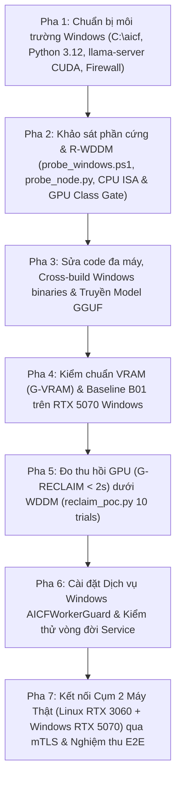

# KẾ HOẠCH TRIỂN KHAI & NGHIỆM THU TRÊN MÁY WINDOWS THẬT (`192.168.1.49`)
*(Tài liệu bàn giao cho Agent thực thi — Đã khảo sát thực tế hạ tầng)*

> **Mục đích tài liệu:** Hướng dẫn từng bước (Step-by-Step Runbook & WBS) để Agent thực thi triển khai, đo kiểm và nghiệm thu toàn bộ phần việc Windows còn mở trong [`KE_HOACH_THUC_HIEN_AI_COMPUTE_FABRIC_HF.md`](file:///mnt/2d4726e7-046b-47c7-b9a9-d2a9cc0cfc8d/Work/AIComputeFabric/KE_HOACH_THUC_HIEN_AI_COMPUTE_FABRIC_HF.md) (Mục `H.2 P0.1`, `H.4 P2.1`, `H.6 P4.1`, `H.11 D06/R-WDDM`, `Phần I.4`) và [`ai-compute-fabric/deploy/windows/HUONG_DAN_CHAY_TREN_WINDOWS.md`](file:///mnt/2d4726e7-046b-47c7-b9a9-d2a9cc0cfc8d/Work/AIComputeFabric/ai-compute-fabric/deploy/windows/HUONG_DAN_CHAY_TREN_WINDOWS.md).
> **Mô hình kiến trúc đã chốt:** **Máy Windows (`192.168.1.49`) CHỈ đóng vai trò là Worker Node (`pc-win-01`)** chạy `AICFWorkerGuard` (`worker-guard.exe` + `llama-server.exe`) và kết nối qua mTLS về `site-gateway` đặt trên máy chủ Linux (`192.168.1.40`). Không cài đặt `site-gateway` hay `global-control-plane` trên máy Windows.

---

## 1. THÔNG TIN HẠ TẦNG & KẾT QUẢ KHẢO SÁT SƠ BỘ (ĐÃ XÁC MINH)

### 1.1. Thông tin kết nối SSH tới máy Windows đích
| Thông số | Giá trị đã xác minh | Ghi chú kỹ thuật cho Agent thực thi |
|---|---|---|
| **Địa chỉ IP LAN** | `192.168.1.49` | Cùng subnet `/24` với máy Linux hiện tại (`192.168.1.40`) |
| **SSH User / Password** | `fios02` / `123` | Lệnh kết nối tự động: `sshpass -p '123' ssh -o StrictHostKeyChecking=no fios02@192.168.1.49` |
| **SSH Server** | `OpenSSH_for_Windows_7.7` | Thư mục gốc SFTP: `/C:/Users/Fios02` |
| **Quyền hạn phiên SSH** | **Administrator (`IS_ADMIN: True`)** | Tài khoản `Fios02` nằm trong nhóm `Administrators`; phiên SSH có sẵn quyền Elevated để tạo Windows Service (`sc.exe`), đọc PDH Counters và mở Firewall |
| **Default Shell qua SSH** | `cmd.exe` | **LƯU Ý QUAN TRỌNG:** Khi chạy lệnh PowerShell từ xa qua SSH, `cmd.exe` sẽ cắt đứt chuỗi nhiều dòng tại ký tự xuống dòng đầu tiên. Agent **bắt buộc** phải dùng lệnh PowerShell 1 dòng (`powershell -NoProfile -ExecutionPolicy Bypass -Command "..."`), hoặc dùng `-EncodedCommand`, hoặc `scp` file `.ps1` sang rồi chạy `powershell -NoProfile -ExecutionPolicy Bypass -File C:\aicf\...` |

### 1.2. Cấu hình phần cứng & hệ điều hành máy Windows (`192.168.1.49`)
| Thành phần | Thông số thực tế đo qua SSH | Ý nghĩa với dự án `ai-compute-fabric` |
|---|---|---|
| **Hostname / OS** | `DESKTOP-2MJNHTH` — `Microsoft Windows 10 Pro` (Build `19041.2673`) | Hệ điều hành mục tiêu của đội máy văn phòng |
| **CPU** | `AMD Ryzen 7 9700X 8-Core Processor` (8 nhân / 16 luồng) | Kiến trúc Zen 5, hỗ trợ đầy đủ `SSE3`, `AVX2`, `FMA`, `F16C`, `AVX-512` (`avx512f`, `avx512bw`, `avx512vl`) — lý tưởng để kiểm chứng cổng `core/hardware_profiler/cpu_isa.py` trên Windows |
| **RAM hệ thống** | `61.6 GB` khả dụng (64 GB vật lý) | Dư sức kiểm thử cả model Dense lẫn Hybrid/MoE offload |
| **GPU** | `NVIDIA GeForce RTX 5070` — **12.227 MiB (12 GB VRAM)** | Kiến trúc NVIDIA Blackwell (`SM 12.0` / Compute Capability `12.0`), cùng phân khúc 12 GB VRAM chuẩn của dự án |
| **NVIDIA Driver & Mode** | Driver `617.42`, `CUDA UMD 13.4`, **Driver-Model: `WDDM`** | Dưới WDDM, `nvidia-smi` đã xác nhận in `N/A` ở cột `GPU Memory Usage` theo từng tiến trình (xác nhận rủi ro `R-WDDM`). VRAM nền của Windows (`dwm.exe`, `explorer.exe`, `NVIDIA Overlay.exe`) đang chiếm `~276 MiB` |
| **Mạng (NIC)** | `Realtek Gaming 2.5GbE Family Controller` (`LinkSpeed: 2.5 Gbps`) | Có kết nối Internet trực tiếp (`curl.exe` 8.0.1 và `bsdtar` 3.5.2 có sẵn). Windows Firewall hiện chặn ICMP Ping chiều vào |
| **Ổ đĩa `C:`** | Còn trống **113,5 GB** | Đủ không gian chứa `C:\aicf\` (binaries, Python runtime, `llama-server.exe`, và các model GGUF `Qwen3-4B`/`Qwen3-8B`) |
| **Phần mềm hiện có** | Chưa cài Python thật (chỉ có Microsoft Store stub `WindowsApps\python.exe`), chưa có `llama-server.exe` | Cần cài đặt Python 3.12 (bản chính thức `amd64` cài silent hoặc portable) và tải/chép `llama-server.exe` bản CUDA cho Windows vào `C:\aicf\` |

### 1.3. Thông tin máy điều khiển hiện tại (Linux Host)
- **IP LAN:** `192.168.1.40` (interface `wlp132s0`)
- **GPU trên máy Linux:** `NVIDIA GeForce RTX 3060` (12 GB VRAM)
- **Thư mục gốc dự án:** `/mnt/2d4726e7-046b-47c7-b9a9-d2a9cc0cfc8d/Work/AIComputeFabric/ai-compute-fabric`
- **Thư mục chứa sẵn GGUF Models (`.aicf-work`):** `/mnt/2d4726e7-046b-47c7-b9a9-d2a9cc0cfc8d/Work/AIComputeFabric/.aicf-work`
  - Có sẵn: `Qwen3-0.6B-Q8_0.gguf` (610 MB), `Qwen3-1.7B-Q8_0.gguf` (1,75 GB), `Qwen3-4B-Q4_K_M.gguf` (2,38 GB), `Qwen3-8B-Q4_K_M.gguf` (4,68 GB), `Qwen3-30B-A3B-Q4_K_M.gguf` (17,3 GB), `Qwen3-Embedding-0.6B-Q8_0.gguf` (610 MB), `bge-reranker-v2-m3-Q8_0.gguf` (606 MB).
  - **Mẹo tiết kiệm thời gian:** Không cần tải lại model từ Hugging Face trên máy Windows — dùng `scp` truyền trực tiếp từ `.aicf-work/` trên máy Linux sang `C:\aicf\models\` qua mạng LAN!

---

## 2. NGUYÊN TẮC AN TOÀN & KỶ LUẬT THỰC THI (BẮT BUỘC TUÂN THỦ)

1. **Cô lập thư mục làm việc trên Windows:** Mọi file thực thi, script, model, log và dữ liệu kiểm thử trên máy `192.168.1.49` **bắt buộc** đặt gọn trong `C:\aicf\` (`C:\aicf\bin`, `C:\aicf\llama`, `C:\aicf\models`, `C:\aicf\adapters`, `C:\aicf\pki`, `C:\aicf\logs`, `C:\aicf\work`, `C:\aicf\repo`). Tuyệt đối không xóa hay sửa bất kỳ dữ liệu cá nhân nào trong `C:\Users\Fios02\`.
2. **Trung thực tuyệt đối (Honest Reporting):** Giống như quy tắc trong [`HUONG_DAN_CHAY_TREN_WINDOWS.md`](file:///mnt/2d4726e7-046b-47c7-b9a9-d2a9cc0cfc8d/Work/AIComputeFabric/ai-compute-fabric/deploy/windows/HUONG_DAN_CHAY_TREN_WINDOWS.md): nếu bất kỳ script hay binary nào chạy lần đầu trên Windows bị lỗi, phải ghi nhận nguyên nhân gốc vào báo cáo và sửa trong code nguồn của repo kèm unit/integration test, không được ngụy tạo file JSON kết quả.
3. **Không làm treo GPU của máy Windows:** Sau mỗi bài đo hoặc khi kết thúc, phải đảm bảo không còn tiến trình `llama-server.exe` mồ côi nào giữ VRAM ngoài sự quản lý của `AICFWorkerGuard`.
4. **Bảo toàn cổng `make verify-release-v1`:** Mọi chỉnh sửa code Go/Python/PowerShell để tương thích Windows và chạy đa máy phải vượt qua toàn bộ `make verify-release-v1` (Go tests `-race`, Python `pytest`, `golangci-lint`, `ruff`, `mypy`, `build-cross`) trên máy Linux.

---

## 3. CÁC PHÁT HIỆN TRONG CODE HIỆN TẠI CẦN SỬA TRƯỚC KHI TRIỂN KHAI ĐA MÁY

Trước khi copy binary sang Windows, Agent thực thi cần kiểm tra và khắc phục **4 điểm kỹ thuật** sau trong codebase:

### 3.1. Sửa `LlamaEngine` cho phép cấu hình địa chỉ lắng nghe (`--engine-host`) khi chạy khác máy với Gateway
- **Hiện trạng:** Trong [`apps/worker-guard/engine.go`](file:///mnt/2d4726e7-046b-47c7-b9a9-d2a9cc0cfc8d/Work/AIComputeFabric/ai-compute-fabric/apps/worker-guard/engine.go#L142), hàm `Args()` đang gán cứng `"--host", "127.0.0.1"`.
- **Hệ quả:** Khi `worker-guard.exe` chạy trên Windows (`192.168.1.49`) và đăng ký vào `site-gateway` trên Linux (`192.168.1.40`) với `--advertise-host 192.168.1.49`, `site-gateway` sẽ gửi request suy luận tới `http://192.168.1.49:18090`. Nếu `llama-server.exe` chỉ bind `127.0.0.1`, kết nối từ `192.168.1.40` sẽ bị từ chối (`Connection refused`).
- **Cách sửa:**
  1. Trong [`apps/worker-guard/engine.go`](file:///mnt/2d4726e7-046b-47c7-b9a9-d2a9cc0cfc8d/Work/AIComputeFabric/ai-compute-fabric/apps/worker-guard/engine.go): Thêm trường `Host string` vào struct `LlamaEngine` (nếu `e.Host == ""` thì mặc định `"127.0.0.1"` để giữ nguyên tính bảo mật loopback mặc định và không làm gãy bất kỳ unit test cũ nào). Trong `Args()`, truyền `"--host", host`. Lưu ý trong `Start()`, healthcheck vẫn gọi `http://127.0.0.1:%d/health` (vì dù bind `127.0.0.1` hay `0.0.0.0` thì `127.0.0.1` trên local vẫn luôn truy cập được; nếu `e.Host` là một IP cụ thể khác `0.0.0.0` và `127.0.0.1` thì có thể gọi `http://127.0.0.1:%d/health` khi bind `0.0.0.0`).
  2. Trong [`apps/worker-guard/main.go`](file:///mnt/2d4726e7-046b-47c7-b9a9-d2a9cc0cfc8d/Work/AIComputeFabric/ai-compute-fabric/apps/worker-guard/main.go): Thêm cờ `--engine-host` (mặc định `"127.0.0.1"`; khi triển khai đa máy qua LAN có thể đặt `--engine-host 0.0.0.0` hoặc `--engine-host 192.168.1.49`).

### 3.2. Đọc tên GPU thực tế từ `nvidia-smi` thay vì gán cứng `"NVIDIA GPU"`
- **Hiện trạng:** Trong [`apps/worker-guard/main.go`](file:///mnt/2d4726e7-046b-47c7-b9a9-d2a9cc0cfc8d/Work/AIComputeFabric/ai-compute-fabric/apps/worker-guard/main.go#L94), `Reporter` đang truyền `GPUName: "NVIDIA GPU"`.
- **Cách sửa:** Thêm hàm `GPUName(index int) string` trong [`apps/worker-guard/gpu.go`](file:///mnt/2d4726e7-046b-47c7-b9a9-d2a9cc0cfc8d/Work/AIComputeFabric/ai-compute-fabric/apps/worker-guard/gpu.go) gọi `nvidia-smi -i <index> --query-gpu=name --format=csv,noheader` (nếu lỗi thì fallback về `"NVIDIA GPU"`). Khi đó trên giao diện `site-gateway`, node Linux hiện `NVIDIA GeForce RTX 3060` và node Windows hiện `NVIDIA GeForce RTX 5070`.

### 3.3. Nâng cấp [`deploy/windows/install-service.ps1`](file:///mnt/2d4726e7-046b-47c7-b9a9-d2a9cc0cfc8d/Work/AIComputeFabric/ai-compute-fabric/deploy/windows/install-service.ps1) hỗ trợ đầy đủ mTLS và thư mục Model/Adapter
- **Hiện trạng:** `install-service.ps1` chưa có tham số cho mTLS (`-TlsCA`, `-TlsCert`, `-TlsKey`, `-TlsServerName`), `-WorkerId`, `-Listen`, `-EngineHost`, `-ModelsDir`, `-AdaptersDir`, `-EngineLog`, `-Parallel`, `-Ctx`.
- **Cách sửa:** Bổ sung các tham số tùy chọn này vào `install-service.ps1` (giữ tương thích ngược với các tham số cũ `-Bin`, `-LlamaServer`, `-Model`, `-Gateway`, `-AdvertiseHost`, `-Name`, `-HeadroomMiB`).

### 3.4. Bổ sung nhánh Windows cho [`benchmarks/hardware/probe_node.py`](file:///mnt/2d4726e7-046b-47c7-b9a9-d2a9cc0cfc8d/Work/AIComputeFabric/ai-compute-fabric/benchmarks/hardware/probe_node.py)
- **Hiện trạng:** `probe_node.py` trên Windows chưa tìm `nvidia-smi.exe` ở `%SystemRoot%\System32\nvidia-smi.exe` nếu thiếu trong PATH, chưa lấy cờ ISA từ `core.hardware_profiler.cpu_isa.windows_flags()`, và chưa lấy tổng RAM qua `ctypes.windll.kernel32.GlobalMemoryStatusEx`.
- **Cách sửa:** Cập nhật `probe_node.py` để khi chạy trên `sys.platform == "win32"`, script trả về đầy đủ `cpu.isa`, `ram.total_bytes`, và `gpus` chuẩn xác mà không làm hỏng test hiện có trên Linux.

---

## 4. KẾ HOẠCH THỰC THI CHI TIẾT (7 GIAI ĐOẠN — WBS & CHECK PASS)



---

### PHA 1: Chuẩn bị môi trường trên máy Windows (`192.168.1.49`)

#### Công việc 1.1: Tạo cấu trúc thư mục `C:\aicf` và mở Windows Firewall nội bộ LAN
Chạy từ máy Linux qua SSH:
```bash
sshpass -p '123' ssh -o StrictHostKeyChecking=no fios02@192.168.1.49 \
  'powershell -NoProfile -ExecutionPolicy Bypass -Command "New-Item -ItemType Directory -Force -Path C:\aicf,C:\aicf\bin,C:\aicf\llama,C:\aicf\models,C:\aicf\adapters,C:\aicf\pki,C:\aicf\logs,C:\aicf\work,C:\aicf\repo,C:\aicf\reports | Out-Null; New-NetFirewallRule -DisplayName \"AICF-LAN-Inbound\" -Direction Inbound -Action Allow -Protocol TCP -LocalPort 8099,18090 -RemoteAddress 192.168.1.0/24 -ErrorAction SilentlyContinue | Out-Null; New-NetFirewallRule -DisplayName \"AICF-LAN-ICMPv4\" -Direction Inbound -Action Allow -Protocol ICMPv4 -IcmpType 8 -RemoteAddress 192.168.1.0/24 -ErrorAction SilentlyContinue | Out-Null; Write-Host \"DIRS_AND_FIREWALL_OK\""'
```
- **Check Pass 1.1:** `ping -c 3 192.168.1.49` từ máy Linux nhận được phản hồi (`0% packet loss`, ghi nhận RTT `min/avg/max`).

#### Công việc 1.2: Cài đặt Python 3.12 (64-bit) trên máy Windows
Do máy Windows mới chỉ có Microsoft Store alias giả (`WindowsApps\python.exe`), cài đặt Python 3.12 chính thức ở chế độ im lặng (`silent install`):
```bash
sshpass -p '123' ssh -o StrictHostKeyChecking=no fios02@192.168.1.49 \
  'powershell -NoProfile -ExecutionPolicy Bypass -Command "if (-not (Test-Path \"C:\Program Files\Python312\python.exe\")) { curl.exe -L -o C:\aicf\python-3.12.8-amd64.exe https://www.python.org/ftp/python/3.12.8/python-3.12.8-amd64.exe; Start-Process -FilePath C:\aicf\python-3.12.8-amd64.exe -ArgumentList \"/quiet InstallAllUsers=1 PrependPath=1 Include_test=0\" -Wait }; & \"C:\Program Files\Python312\python.exe\" --version"'
```
> **Lưu ý:** Luôn có thể gọi đường dẫn tuyệt đối `"C:\Program Files\Python312\python.exe"` trong các lệnh SSH để không phụ thuộc vào việc làm mới biến môi trường `PATH` hay bị alias `WindowsApps\python.exe` chặn.

- **Check Pass 1.2:** `"C:\Program Files\Python312\python.exe" --version` in ra `Python 3.12.8`.

#### Công việc 1.3: Cài đặt `llama-server.exe` và `llama-bench.exe` bản CUDA cho Windows (`C:\aicf\llama\`)
- **Lưu ý đặc biệt về GPU RTX 5070 (Blackwell `sm_120`):**
  1. Kiểm tra bản phát hành chính thức của `ggml-org/llama.cpp` trên GitHub Releases (`https://api.github.com/repos/ggml-org/llama.cpp/releases/latest`).
  2. Ưu tiên tải bộ gói Windows CUDA x64 mới nhất hỗ trợ CUDA 12.4 / 12.8 / 13.x:
     - Gói runtime CUDA DLLs: `cudart-llama-bin-win-cuda-*-x64.zip`
     - Gói binaries: `llama-*-bin-win-cuda-*-x64.zip`
  3. Giải nén cả 2 file `.zip` vào cùng thư mục `C:\aicf\llama\` (bằng `tar.exe -xf ... -C C:\aicf\llama` hoặc `Expand-Archive`).
  4. Kiểm tra các file `C:\aicf\llama\llama-server.exe`, `C:\aicf\llama\llama-bench.exe` và các file `ggml-cuda.dll`, `cublas64_*.dll`, `cudart64_*.dll`.
- **Check Pass 1.3:** Chạy `C:\aicf\llama\llama-server.exe --version` và `C:\aicf\llama\llama-bench.exe --help` qua SSH trả về `exit code = 0` và nhận diện được thiết bị `NVIDIA GeForce RTX 5070`.

---

### PHA 2: Khảo sát phần cứng Windows, đóng rủi ro `R-WDDM` và kiểm chứng Cổng Phần Cứng (P0.1 / P4.1)

#### Công việc 2.1: Đồng bộ mã nguồn `ai-compute-fabric` sang `C:\aicf\repo`
- Thực hiện các chỉnh sửa nhỏ ở **Mục 3** (`engine.go`, `gpu.go`, `main.go`, `install-service.ps1`, `probe_node.py`) trên máy Linux.
- Đóng gói mã nguồn sạch (không gồm `.venv`, `.demo`, `.git`) và truyền sang `C:\aicf\repo`:
```bash
tar --exclude='.venv' --exclude='.demo' --exclude='.pytest_cache' --exclude='.mypy_cache' --exclude='.ruff_cache' \
  -czf /tmp/aicf-repo.tar.gz -C /mnt/2d4726e7-046b-47c7-b9a9-d2a9cc0cfc8d/Work/AIComputeFabric/ai-compute-fabric .
sshpass -p '123' scp -o StrictHostKeyChecking=no /tmp/aicf-repo.tar.gz fios02@192.168.1.49:/C:/aicf/aicf-repo.tar.gz
sshpass -p '123' ssh -o StrictHostKeyChecking=no fios02@192.168.1.49 \
  'powershell -NoProfile -ExecutionPolicy Bypass -Command "tar.exe -xzf C:\aicf\aicf-repo.tar.gz -C C:\aicf\repo"'
```

#### Công việc 2.2: Chạy `probe_windows.ps1` và `probe_node.py` (Trả lời câu hỏi `R-WDDM` & `D06`)
- Chạy trên máy Windows:
  1. `C:\aicf\repo\benchmarks\hardware\probe_windows.ps1 -Out C:\aicf\reports\probe_windows.json`
  2. `"C:\Program Files\Python312\python.exe" C:\aicf\repo\benchmarks\hardware\probe_node.py --out C:\aicf\reports\probe_node_windows.json`
- **Lưu ý quan trọng:** Chạy `probe_windows.ps1` **hai lần**:
  - Lần 1: Khi GPU đang rảnh (chỉ có Windows desktop).
  - Lần 2 (ở Pha 4 khi `llama-server.exe` đang nạp model trên GPU): Để kiểm chứng xem bộ đếm PDH `\GPU Process Memory(*)\Dedicated Usage` trên Windows 10 WDDM có hiển thị đúng dung lượng VRAM của tiến trình `llama-server` trong khi `nvidia-smi --query-compute-apps` báo `[N/A]` hay không! Đây chính là câu trả lời thực nghiệm cho quyết định mở **D06** (`PDH GPU Process Memory đủ tin cậy trên WDDM?`) trong kế hoạch.

#### Công việc 2.3: Kiểm chứng Cổng CPU ISA (`cpu_isa.py`) và Cổng Hạng GPU (`gpu_class.py`) trên Windows thật
Chạy trên máy Windows từ `C:\aicf\repo`:
```powershell
& "C:\Program Files\Python312\python.exe" -c "import json; from core.hardware_profiler import cpu_isa as c, gpu_class as g; f=c.detect_flags(); print(json.dumps({'flags': sorted(f), 'allowed_builds': c.allowed_builds(f), 'selected_build': c.select_build(f), 'rtx5070_class': g.classify_gpu('NVIDIA GeForce RTX 5070', 12, 0, 12227)}, indent=2))"
```
- **Check Pass Pha 2:**
  - Thu về máy Linux 2 file báo cáo:
    - `ai-compute-fabric/benchmarks/reports/p0_probe_windows_rtx5070.json`
    - `ai-compute-fabric/benchmarks/reports/p0_probe_node_windows_rtx5070.json`
  - `cpu_isa.detect_flags()` trên Ryzen 7 9700X phát hiện đúng `avx2` và `avx512f`, chọn `llama_cpp_avx512` (hoặc `llama_cpp_avx2`), không crash.

---

### PHA 3: Biên dịch chéo `worker-guard.exe` & Truyền Model GGUF sang Worker Windows

#### Công việc 3.1: Biên dịch chéo `worker-guard.exe` (`GOOS=windows GOARCH=amd64`) trên máy Linux
*(Máy Windows chỉ đóng vai trò Worker nên chỉ triển khai `worker-guard.exe` lên máy Windows; vẫn giữ `make build-cross` để kiểm tra biên dịch toàn bộ monorepo).*
```bash
cd /mnt/2d4726e7-046b-47c7-b9a9-d2a9cc0cfc8d/Work/AIComputeFabric/ai-compute-fabric
mkdir -p dist/windows
(cd apps/worker-guard && GOOS=windows GOARCH=amd64 go build -o ../../dist/windows/worker-guard.exe .)
```

#### Công việc 3.2: Truyền Binaries và GGUF Models sang máy Windows qua LAN 2.5GbE
Copy `worker-guard.exe`, `Qwen3-0.6B-Q8_0.gguf`, `Qwen3-4B-Q4_K_M.gguf`, và `Qwen3-8B-Q4_K_M.gguf` sang máy Windows:
```bash
sshpass -p '123' scp -o StrictHostKeyChecking=no \
  ai-compute-fabric/dist/windows/worker-guard.exe \
  fios02@192.168.1.49:/C:/aicf/bin/worker-guard.exe

sshpass -p '123' scp -o StrictHostKeyChecking=no \
  .aicf-work/Qwen3-0.6B-Q8_0.gguf \
  .aicf-work/Qwen3-4B-Q4_K_M.gguf \
  .aicf-work/Qwen3-8B-Q4_K_M.gguf \
  fios02@192.168.1.49:/C:/aicf/models/
```
- **Check Pass Pha 3:** Kiểm tra kích thước và SHA256 của các file `.gguf` và `worker-guard.exe` trên `C:\aicf\` khớp 100% với máy Linux.

---

### PHA 4: Kiểm chuẩn VRAM (`G-VRAM`) & Đo Baseline `B01` trên Windows + RTX 5070

#### Công việc 4.1: Đo Baseline `B01` (`llama-bench.exe`) trên Windows RTX 5070
- Chạy `llama-bench.exe` với `Qwen3-4B-Q4_K_M.gguf` và `Qwen3-8B-Q4_K_M.gguf` (`-p 512 -p 4096 -n 128 -r 3 -ngl 99 -fa 1 -o json`):
  - Lưu kết quả về `ai-compute-fabric/benchmarks/reports/p0_B01_llamabench_Qwen3-4B_win_rtx5070.json` và `p0_B01_llamabench_Qwen3-8B_win_rtx5070.json`.
- Trong lúc `llama-server.exe` đang giữ `Qwen3-8B-Q4_K_M.gguf` trên GPU, chạy lại `probe_windows.ps1 -Out C:\aicf\reports\probe_windows_loaded.json` để ghi nhận chính xác giá trị của bộ đếm `\GPU Process Memory(*)\Dedicated Usage` đối chiếu với buffer size trong log `llama-server` và tổng `nvidia-smi memory.used`.

#### Công việc 4.2: Kiểm tra độ chính xác 6-Bucket VRAM Estimator trên Windows
- Đối chiếu số liệu buffer (`CUDA0 model buffer size`, `CUDA0 KV buffer size`, `CUDA0 compute buffer size`) và mức tăng `nvidia-smi memory.used` trên Windows WDDM với công thức `CalibratedLlamaCppVRAM` trong `core/vram-estimator`.
- Ghi nhận chi phí ngữ cảnh CUDA (CUDA context overhead) trên Windows WDDM + RTX 5070 (so với `~133 MiB` đã đo trên Linux RTX 3060).
- **Check Pass Pha 4:** Sai số ước lượng VRAM nằm trong ngưỡng `G-VRAM` (`<= max(5%, 300 MiB)`).

---

### PHA 5: Nghiệm thu Cổng Thu Hồi GPU (`G-RECLAIM < 2.0 s`) trên Windows WDDM (P2.1)

#### Công việc 5.1: Chạy `reclaim_poc.py` (10 trials) trên máy Windows thật
Chạy từ máy Windows theo đúng đặc tả trong [`HUONG_DAN_CHAY_TREN_WINDOWS.md`](file:///mnt/2d4726e7-046b-47c7-b9a9-d2a9cc0cfc8d/Work/AIComputeFabric/ai-compute-fabric/deploy/windows/HUONG_DAN_CHAY_TREN_WINDOWS.md):
```powershell
& "C:\Program Files\Python312\python.exe" C:\aicf\repo\benchmarks\hardware\reclaim_poc.py `
  --guard C:\aicf\bin\worker-guard.exe `
  --server C:\aicf\llama\llama-server.exe `
  --engine-model C:\aicf\models\Qwen3-8B-Q4_K_M.gguf `
  --user-model C:\aicf\models\Qwen3-4B-Q4_K_M.gguf `
  --user-ctx 24576 `
  --trials 10 `
  --headroom 1536 `
  --out C:\aicf\reports\p2_gpu_reclaim_poc_win_rtx5070.json `
  --workdir C:\aicf\work
```
> **Điểm cần quan sát kỹ:**
> - Trên Windows WDDM, `own` từ `nvidia-smi --query-compute-apps` là `0` (vì WDDM trả `[N/A]`), nên `worker-guard` sẽ kích hoạt nhánh fallback: lấy `expected = ModelMiB + KVMiB + ComputeMiB` từ log `llama-server` và xác nhận đã giải phóng khi `pre.UsedMiB - s.UsedMiB >= 0.9 * expected` (dòng 254–278 của [`apps/worker-guard/guard.go`](file:///mnt/2d4726e7-046b-47c7-b9a9-d2a9cc0cfc8d/Work/AIComputeFabric/ai-compute-fabric/apps/worker-guard/guard.go#L254-L278)).
> - Đồng thời khi khởi động lại sau khi thu hồi (`StYielded` -> `StRunning`), kiểm tra dòng 182 của `guard.go`: `need := g.lastOwn + g.cfg.HeadroomMiB`. **CHÚ Ý PHÁT HIỆN QUAN TRỌNG:** Trên Windows WDDM, vì `own` luôn bằng `0`, `g.lastOwn` cũng bằng `0`, dẫn đến `need = g.cfg.HeadroomMiB + 1` thay vì `expectedEngineMiB + HeadroomMiB`! Nếu người dùng vẫn đang chiếm 7 GB VRAM (còn trống 4,5 GB > Headroom 1,5 GB nhưng không đủ 5,5 GB + 1,5 GB = 7 GB cho Qwen3-8B), `worker-guard` trên Windows có nguy cơ khởi động lại `llama-server` quá sớm khi `lastOwn == 0`!
> - **Cách sửa triệt để trong `guard.go` (Agent thực thi cần kiểm tra và áp dụng):** Khi `own == 0` nhưng `g.eng.Buffers()` đã báo cáo `b.ModelMiB + b.KVMiB + b.ComputeMiB > 0`, gán `own = uint64(b.ModelMiB + b.KVMiB + b.ComputeMiB)` để cả `Snapshot().EngineMiB`, `External` (Ngăn 1: `UsedMiB - own`), và ngưỡng khởi động lại `lastOwn + HeadroomMiB` hoạt động chính xác 100% trên Windows WDDM!

- **Check Pass Pha 5:**
  - `n_ok == 10/10`, `gate_under_2000ms: true` (`p95_ms < 2000`, `max_ms < 2000`).
  - Thu thập báo cáo về `ai-compute-fabric/benchmarks/reports/p2_gpu_reclaim_poc_win_rtx5070.json`.

---

### PHA 6: Cài đặt & Nghiệm thu Windows Service `AICFWorkerGuard` (`install-service.ps1`)

#### Công việc 6.1: Cấp chứng chỉ mTLS cho node Windows (`pc-win-01`) và truyền sang `C:\aicf\pki\`
Trên máy Linux (`192.168.1.40`):
```bash
cd /mnt/2d4726e7-046b-47c7-b9a9-d2a9cc0cfc8d/Work/AIComputeFabric/ai-compute-fabric
go run ./apps/site-gateway/cmd/pki -out .demo/pki \
  -gateway-hosts "127.0.0.1,localhost,192.168.1.40" \
  -workers "pc-001,pc-win-01"
sshpass -p '123' scp -o StrictHostKeyChecking=no \
  .demo/pki/ca.crt .demo/pki/pc-win-01.crt .demo/pki/pc-win-01.key \
  fios02@192.168.1.49:/C:/aicf/pki/
```

#### Công việc 6.2: Cài đặt Windows Service bằng `install-service.ps1` và kiểm thử vòng đời SCM
Chạy trên máy Windows:
```powershell
C:\aicf\repo\deploy\windows\install-service.ps1 `
  -Bin C:\aicf\bin\worker-guard.exe `
  -LlamaServer C:\aicf\llama\llama-server.exe `
  -Model C:\aicf\models\Qwen3-4B-Q4_K_M.gguf `
  -ModelsDir C:\aicf\models `
  -AdaptersDir C:\aicf\adapters `
  -Gateway "192.168.1.40:17443" `
  -AdvertiseHost "192.168.1.49" `
  -EngineHost "0.0.0.0" `
  -Listen "0.0.0.0:8099" `
  -WorkerId "pc-win-01" `
  -TlsCA "C:\aicf\pki\ca.crt" `
  -TlsCert "C:\aicf\pki\pc-win-01.crt" `
  -TlsKey "C:\aicf\pki\pc-win-01.key" `
  -TlsServerName "192.168.1.40" `
  -EngineLog "C:\aicf\logs\engine.log"
```
- Kiểm tra vòng đời Service Control Manager (SCM):
  1. `Get-Service AICFWorkerGuard` -> `Status == Running`.
  2. Chờ ~15 giây để `llama-server.exe` nạp model, sau đó kiểm tra từ máy Linux: `curl -s http://192.168.1.49:8099/api/state` -> `state == "running"`, `buckets_bytes.Weights > 0`, `engine_pid > 0`.
  3. Kiểm tra dừng dịch vụ sạch sẽ: `Stop-Service AICFWorkerGuard` -> xác nhận tiến trình `llama-server.exe` cũng tự động tắt theo (`Get-Process llama-server -ErrorAction SilentlyContinue` trả về rỗng) và VRAM trên `192.168.1.49` quay về mức nền `~276 MiB`.
  4. Khởi động lại dịch vụ: `Start-Service AICFWorkerGuard` -> xác nhận `state` lên lại `"running"`.

- **Check Pass Pha 6:** Lưu bằng chứng kiểm thử dịch vụ Windows vào `ai-compute-fabric/benchmarks/reports/p2_windows_service_lifecycle_rtx5070.json`.

---

### PHA 7: Kết nối Cụm Đa Máy Thật (Gateway + Worker Linux `192.168.1.40` ↔ Worker Windows `192.168.1.49`) & Nghiệm thu Đầu-Cuối

#### Công việc 7.1: Cấu hình `deploy/demo/run_demo.sh` trên máy Linux (`192.168.1.40`) để nhận Worker Windows (`pc-win-01`) tự động
1. Cập nhật [`deploy/demo/run_demo.sh`](file:///mnt/2d4726e7-046b-47c7-b9a9-d2a9cc0cfc8d/Work/AIComputeFabric/ai-compute-fabric/deploy/demo/run_demo.sh) trên máy Linux (`192.168.1.40`):
   - Khi sinh PKI (`$D/bin/pki`), truyền `-gateway-hosts "127.0.0.1,localhost,192.168.1.40"` và `-workers "pc-001,pc-win-01"`.
   - Cho `site-gateway` lắng nghe trên `BIND_HOST="${BIND_HOST:-0.0.0.0}"` (`-grpc "$BIND_HOST:$GRPC_PORT" -http "$BIND_HOST:$HTTP_PORT"`) để Worker Windows (`192.168.1.49`) kết nối vào cổng `17443` được ngay khi chạy `run_demo.sh`.
2. Trên máy Windows (`192.168.1.49`), dịch vụ `AICFWorkerGuard` (`pc-win-01`, RTX 5070) chạy nền liên tục và tự động kết nối gRPC mTLS về `192.168.1.40:17443`.
3. Kiểm tra danh sách worker trên Gateway:
   ```bash
   curl -s http://127.0.0.1:18080/api/stats | jq .
   ```
   Xác nhận có **2 worker thật trên 2 hệ điều hành khác nhau** cùng ở trạng thái `running`:
   - `pc-001` (Linux, `NVIDIA GeForce RTX 3060`, 12 GB VRAM)
   - `pc-win-01` (Windows 10 Pro, `NVIDIA GeForce RTX 5070`, 12 GB VRAM — chỉ chạy Worker)

#### Công việc 7.2: Kiểm thử Điều khiển Từ Xa & Suy Luận Đa Máy qua Gateway
1. **Kiểm thử điều khiển Pause / Resume từ Gateway sang Windows Worker (`pc-win-01`):**
   - Gọi `POST /api/workers/pc-win-01/pause` (với `Authorization: Bearer <admin-token>`) -> xác nhận `pc-win-01` trên máy Windows dừng `llama-server.exe`, giải phóng VRAM và chuyển sang trạng thái `paused` trong `< 4s`.
   - Gọi `POST /api/workers/pc-win-01/resume` -> xác nhận `pc-win-01` nạp lại model và quay về `running`.
2. **Kiểm thử Đổi Model từ xa (Live Model Switch) trên Windows Worker:**
   - Gọi `POST http://192.168.1.49:8099/api/engine` để chuyển model giữa `Qwen3-4B-Q4_K_M.gguf` và `Qwen3-8B-Q4_K_M.gguf`, xác nhận `worker-guard.exe` đổi model thành công.
3. **Kiểm thử Suy luận (`/v1/chat/completions`) và Chia tải song song (Data Parallelism) trên 2 máy thật:**
   - Gửi đồng thời nhiều request `/v1/chat/completions` qua `site-gateway` (`http://192.168.1.40:18080/v1/chat/completions`) và đo thông lượng tổng hợp khi:
     - Chỉ bật 1 node Linux (`pc-001` - RTX 3060)
     - Chỉ bật 1 node Windows (`pc-win-01` - RTX 5070)
     - Bật cả 2 node (`pc-001` + `pc-win-01` chạy song song)
   - Lưu báo cáo thực nghiệm đa máy đầu tiên của dự án vào:
     `ai-compute-fabric/benchmarks/reports/p2_multinode_linux3060_win5070_e2e.json`.

#### Công việc 7.3: Cập nhật Tài liệu Kế hoạch & Chạy Cổng Kiểm Chứng Phát Hành
1. Cập nhật kết quả đo thực tế trên Windows (`probe_windows`, `B01`, `reclaim_poc`, `Windows Service`, `Multi-node Linux + Windows`) vào:
   - [`KE_HOACH_THUC_HIEN_AI_COMPUTE_FABRIC_HF.md`](file:///mnt/2d4726e7-046b-47c7-b9a9-d2a9cc0cfc8d/Work/AIComputeFabric/KE_HOACH_THUC_HIEN_AI_COMPUTE_FABRIC_HF.md) (đánh dấu `[x]` các mục Windows đã hoàn thành bằng số đo thật tại `H.4 P2.1`, `H.6 P4.1`, `H.11 D06`, và thêm mục mới trong `Phần I`).
   - [`ai-compute-fabric/deploy/windows/HUONG_DAN_CHAY_TREN_WINDOWS.md`](file:///mnt/2d4726e7-046b-47c7-b9a9-d2a9cc0cfc8d/Work/AIComputeFabric/ai-compute-fabric/deploy/windows/HUONG_DAN_CHAY_TREN_WINDOWS.md) (cập nhật trạng thái từ "chưa từng chạy trên Windows thật" sang "đã chạy và nghiệm thu trên Windows 10 Pro + RTX 5070").
   - [`ai-compute-fabric/README.md`](file:///mnt/2d4726e7-046b-47c7-b9a9-d2a9cc0cfc8d/Work/AIComputeFabric/ai-compute-fabric/README.md).
2. Chạy lại cổng kiểm tra toàn diện trên máy Linux:
   ```bash
   cd /mnt/2d4726e7-046b-47c7-b9a9-d2a9cc0cfc8d/Work/AIComputeFabric/ai-compute-fabric
   make verify-release-v1
   ```

---

## 5. DANH SÁCH DELIVERABLES & TIÊU CHUẨN NGHIỆM THU CUỐI CÙNG (DEFINITION OF DONE)

Agent thực thi chỉ được phép báo cáo hoàn thành khi **tất cả 8 mục kiểm tra dưới đây đạt `PASS`**:

| # | Hạng mục nghiệm thu | Bằng chứng bắt buộc (File trong repo) | Ngưỡng đạt (Gate) |
|:-:|---|---|---|
| **1** | **Khảo sát phần cứng Windows & WDDM (`P0.1` / `D06`)** | `benchmarks/reports/p0_probe_windows_rtx5070.json`<br>`benchmarks/reports/p0_probe_node_windows_rtx5070.json` | Ghi nhận đầy đủ thông số WDDM, kết quả `nvidia-smi` per-process (`[N/A]`) và kết quả bộ đếm PDH `\GPU Process Memory(*)\Dedicated Usage` khi nạp model |
| **2** | **Cổng CPU ISA & Hạng GPU trên Windows (`P4.1`)** | Phần `cpu_isa` & `gpu_class` trong báo cáo probe + unit test | Nhận diện đúng `avx2`, `avx512f` trên Ryzen 7 9700X; xếp hạng RTX 5070 12 GB vào `group`/`standalone` chính xác |
| **3** | **Baseline `B01` trên Windows RTX 5070 (`P0.4`)** | `benchmarks/reports/p0_B01_llamabench_Qwen3-4B_win_rtx5070.json`<br>`benchmarks/reports/p0_B01_llamabench_Qwen3-8B_win_rtx5070.json` | Đo đủ `pp512`, `pp4096`, `tg128` (3 lần lặp), offload 100% layer lên GPU RTX 5070 |
| **4** | **Thu hồi GPU dưới WDDM (`P2.1` / `G-RECLAIM`)** | `benchmarks/reports/p2_gpu_reclaim_poc_win_rtx5070.json` | `10/10` trials thành công, `max_ms < 2000 ms`, `p95_ms < 2000 ms`, 0 crash WDDM |
| **5** | **Kế toán 6 ngăn VRAM trên Windows (`P2.1` / `R-WDDM`)** | Code `apps/worker-guard/guard.go` + `guard_test.go` | Khi `nvidia-smi` per-process trả `0` trên WDDM, `worker-guard` dùng tổng buffer (`Model+KV+Compute`) làm `EngineMiB` và giữ đúng ngưỡng `lastOwn + HeadroomMiB` trước khi tự khởi động lại |
| **6** | **Dịch vụ Windows `AICFWorkerGuard` (`P2.1`)** | `benchmarks/reports/p2_windows_service_lifecycle_rtx5070.json` | `Start-Service` khởi chạy `llama-server.exe`; `Stop-Service` tắt sạch `llama-server.exe` và trả VRAM về nền |
| **7** | **Cụm 2 máy thật Linux + Windows qua mTLS (`P2.2`)** | `benchmarks/reports/p2_multinode_linux3060_win5070_e2e.json` | `site-gateway` (`192.168.1.40`) quản lý đồng thời `pc-001` (Linux RTX 3060) và `pc-win-01` (Windows RTX 5070) qua mTLS; Pause/Resume từ xa và chia tải `/v1/chat/completions` thành công |
| **8** | **Cổng chất lượng mã nguồn (`Release Gate`)** | Chạy `make verify-release-v1` (và cập nhật chữ ký SBOM nếu `go.mod` thay đổi) | `exit code = 0` |
